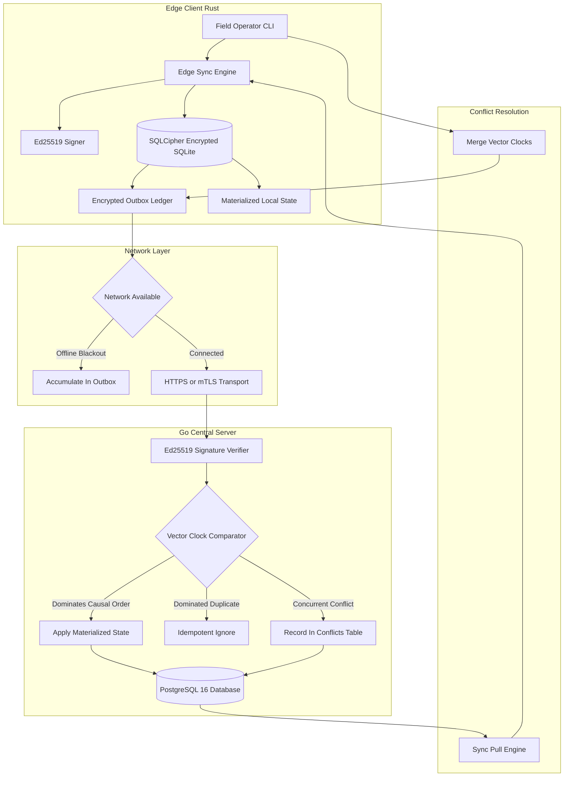

# EdgeSync

[](https://github.com/Akinmoldun/EdgeSync/releases/tag/v1.0.0)
[](client/)
[](server/)
[](server/migrations/)
[](docs/deploy.md)
[](LICENSE)

**DDIL-Resilient, Offline-First Edge Synchronization Engine**

EdgeSync is a dual-tier synchronization system designed for **Denied, Disrupted, Intermittent, and Limited (DDIL)** connectivity environment. It provides cryptographic event sourcing on edge nodes with deterministic causal consistency and explicit conflict surfacing on the server.

---

## Architecture



---

## Tech Stack

- **Edge Client (Rust):**
  - **Runtime:** Rust 2021 Edition
  - **Storage:** SQLite 3 with SQLCipher 256-bit AES-GCM encryption (`rusqlite`)
  - **Cryptography:** Ed25519 digital signatures (`ed25519-dalek`)
  - **Transport:** HTTP/HTTPS with pure Rust TLS client authentication (`reqwest`, `rustls`)
  - **CLI:** Command dispatch and parsing (`clap`)

- **Central Server (Go):**
  - **Runtime:** Go 1.24+
  - **Routing:** Chi HTTP router (`github.com/go-chi/chi/v5`)
  - **Database:** PostgreSQL 16 with connection pooling (`github.com/jackc/pgx/v5`)
  - **Concurrency & Math:** Monotonic Vector Clock algebra and causal dominance engine
  - **Security:** Dual-mode HTTP/HTTPS with mutual TLS (`crypto/tls`, `crypto/x509`)

- **Infrastructure & Deployment:**
  - **Containerization:** Multi-stage Docker container running unprivileged as non-root user `10001:10001`
  - **Cloud:** Fly.io ready (`server/fly.toml`) with `/healthz` monitoring
  - **Local Dev:** Docker Compose PostgreSQL 16

---

## Key Features

- **DDIL Resilience (Zero Data Loss):** Edge nodes operate fully offline during prolonged network blackouts. Events accumulate in an encrypted local outbox and synchronize in atomic batches upon reconnection.
- **Cryptographic Event Integrity (Ed25519):** Every mutation is signed at the edge using device private keys. The central server validates identity and payload signatures before ingestion.
- **Causal Consistency via Vector Clocks:** Completely eliminates wall-clock time dependency. Distributed logical clocks track causal order and detect concurrency without vulnerability to clock drift or NTP spoofing.
- **Encrypted At-Rest Storage (SQLCipher):** Edge SQLite databases are protected with AES-256 encryption, requiring `--db-key` (or `EDGESYNC_DB_KEY`) with fail-fast key validation on page 1.
- **Explicit Conflict Surfacing:** Concurrent writes are never silently discarded. Conflicting events are recorded in a server-side conflict register, and resolution merges vector clocks to prevent phantom future conflicts.
- **Transport Security with Cloud Fallback:** Enforces strict mutual TLS (`tls.RequireAndVerifyClientCert`) for private enclaves, with automatic fallback to standard HTTP for public edge proxies.
- **Strict Financial Precision:** Monetary values are modeled as 64-bit signed integers (`i64` minor currency units) to avoid floating-point inaccuracies.
- **Robust Error Handling:** Rust client code contains zero `unwrap()` or `expect()` invocations in production; Go services enforce strict error propagation.

---

## How to Run Locally

### 1. Prerequisites

- **Docker & Docker Compose**
- **Go 1.24+**
- **Rust 1.80+ (Cargo)**
- **OpenSSL / MSYS2 headers** (for SQLCipher on Windows)

### 2. Start PostgreSQL Database

```bash
docker compose -f docker/docker-compose.yml up -d
```

### 3. Run the DDIL Chaos Simulation Test

The chaos test validates that EdgeSync survives a total network blackout with zero data loss across 10 distinct phases:

```powershell
# Windows (PowerShell)
powershell -ExecutionPolicy Bypass -File scripts\chaos_test.ps1

# Linux / macOS (POSIX Bash)
./scripts/chaos_test.sh
```

### 4. Run the End-to-End Integration Suite

```powershell
# Windows (PowerShell)
powershell -ExecutionPolicy Bypass -File scripts\e2e_test.ps1

# Linux / macOS (POSIX Bash)
./scripts/e2e_test.sh
```

### 5. Run Unit and Component Tests

```bash
# Server tests (Go)
cd server
go test -v ./...

# Client tests (Rust)
cd ../client
cargo test
```

---

## Security Model & Known Limitations

### What is enforced

- **Device identity on push:** Every event pushed to `/sync/push` is verified against the device's registered Ed25519 public key. Unsigned, tampered, or unknown-device events are rejected with `400` or `401`.
- **At-rest encryption:** The edge client's SQLite database is encrypted with SQLCipher (AES-256). Opening it without the correct `--db-key` fails immediately.
- **Event ordering:** Causal ordering is enforced mathematically via Vector Clocks. No wall-clock timestamps are trusted.
- **Idempotency:** Client-generated UUIDs are the primary key for events. Duplicate pushes are silently ignored.

### What is NOT enforced (current limitations)

- **Device identity on pull:** `GET /sync/pull` and `GET /conflicts` do not currently verify device signatures. In a private deployment, this is mitigated by mTLS (`tls.RequireAndVerifyClientCert`). In the public HTTP-fallback demo deployment (used for easy review), this mitigation is disabled.
- **Authorization:** There is no tenant or user scoping. All connected devices share a single global namespace.
- **Key rotation:** Ed25519 device keys are generated once. There is no revocation or rotation mechanism in `v1.0.0`.
- **Transport without mTLS:** When deployed without mTLS (as in the public demo), payloads are transmitted over TLS provided by the edge proxy (Fly.io), but not mutual TLS.
- **Full end-to-end encryption:** Events are signed, not encrypted at rest on the server. Server operators can read payloads.

### Production hardening checklist (out of scope for v1.0.0)

- Wire signature verification into pull/conflicts endpoints
- Add per-device authorization scoping
- Add key revocation endpoint
- Encrypt event payloads with recipient public keys (forward secrecy)

## Documentation

- **Deployment Guide:** [`docs/deploy.md`](docs/deploy.md) - Fly.io cloud deployment manual.
- **Video Walkthrough Script:** [`docs/demo-script.md`](docs/demo-script.md) - Step-by-step recording script.
- **Engineering Article:** [`docs/blog-post.md`](docs/blog-post.md) - Deep dive into Vector Clocks, Ed25519, and SQLCipher.
- **License:** [`LICENSE`](LICENSE) - Standard MIT License.
